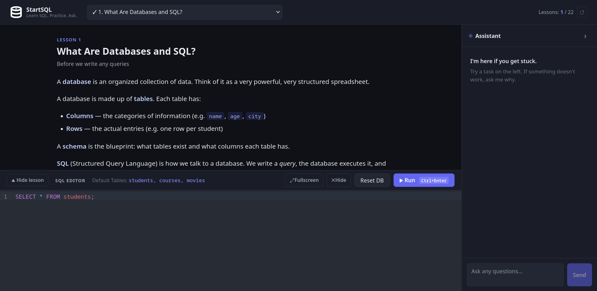

# StartSQL

An interactive SQL learning platform for absolute beginners, with an AI tutor.



## Prerequisites

- Python 3.12+
- Node.js 20+
- A free Groq API key from https://console.groq.com/keys

## Setup

### Backend

```bash
cd backend
```

#### Install dependencies using either [uv](https://docs.astral.sh/uv/) (recommended) or pip

With uv:
```bash
uv sync
```

With pip:

```bash
python -m venv .venv
source .venv/bin/activate    # Windows: .venv\Scripts\activate
pip install -e .
```

#### Create a .env file with your Groq key:

```text
GROQ_API_KEY=your_key_here
```

### Frontend

```bash
cd frontend
npm install
```

### Running

#### Terminal 1 — backend:

```bash
cd backend
# With uv:
uv run uvicorn app.main:app --reload --port 8000

# With pip (venv activated):
uvicorn app.main:app --reload --port 8000
```

#### Terminal 2 — frontend:
```bash
cd frontend
npm run dev
```

#### Open http://localhost:5173

## Project Structure

- frontend/ — React + Vite app; lessons, SQL editor, tasks, AI chat panel
- backend/ — FastAPI service; streams AI replies from Groq using the OpenAI SDK

## How It Works

- Lessons and progress live entirely in the browser
- SQL queries run client-side via sql.js (SQLite in WebAssembly)
- The backend only handles chat: it forwards messages to Groq with lesson/task context and streams tokens back over Server-Sent Events (SSE)
